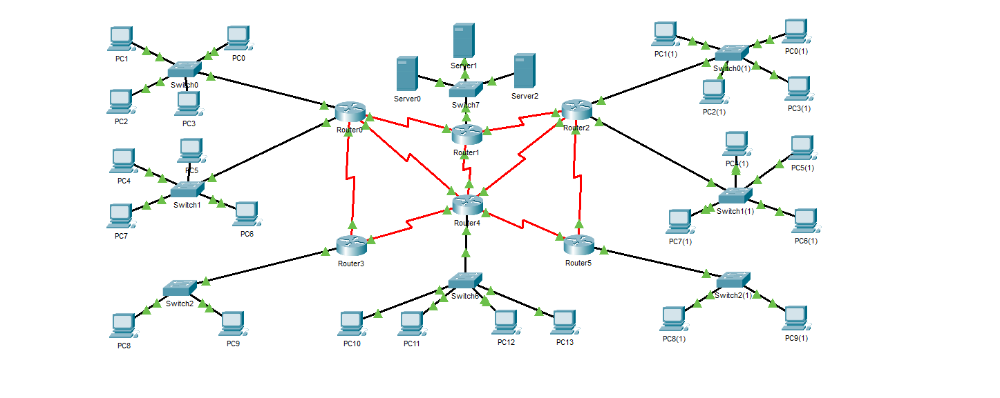

# Large-Scale Multi-Branch Network Implementation Using RIPv1

A large-scale enterprise network designed and simulated using **Cisco Packet Tracer**. The topology connects multiple branch networks, a central core network, and a data center through multiple WAN links.

The project demonstrates **RIPv1 dynamic routing** using classful IPv4 addressing and default subnet masks.

---

## Topology

| **Item** | **Details** |
|---|---|
| Tool | Cisco Packet Tracer |
| Routers | 6 |
| Switches | 8 |
| End Devices | 24 PCs + 3 Servers |
| LAN Segments | 8 |
| WAN Links | 9 |
| Routing Protocol | RIPv1 |
| Addressing | Classful IPv4 |
| Configuration | `configuration.txt` |
| Topology File | `lab.pkt` |
| Screenshot | `topology.png` |

### Network Topology Diagram



---

## Topology Summary

- **Branch-A to Branch-F:** Multiple LAN networks connected through routers and switches.
- **Data Center:** Three servers connected through a dedicated LAN.
- **Core Network:** Interconnected routers providing multiple WAN paths between branches.

---

## IP Addressing Plan

### LAN Networks

| **Network** | **Gateway IP** | **Subnet Mask** |
|---|---|---|
| Branch-A | 192.168.1.1 | 255.255.255.0 |
| Branch-B | 192.168.2.1 | 255.255.255.0 |
| Branch-C | 192.168.3.1 | 255.255.255.0 |
| Data Center | 172.16.2.1 | 255.255.0.0 |
| Core LAN | 172.16.1.1 | 255.255.0.0 |
| Branch-D | 192.168.4.1 | 255.255.255.0 |
| Branch-E | 192.168.5.1 | 255.255.255.0 |
| Branch-F | 192.168.6.1 | 255.255.255.0 |

### WAN Networks

| **Connection** | **Network** |
|---|---|
| Router0 – Router1 | 10.0.0.0/8 |
| Router0 – Router3 | 20.0.0.0/8 |
| Router0 – Router4 | 30.0.0.0/8 |
| Router1 – Router2 | 40.0.0.0/8 |
| Router1 – Router4 | 50.0.0.0/8 |
| Router2 – Router5 | 60.0.0.0/8 |
| Router3 – Router4 | 70.0.0.0/8 |
| Router4 – Router5 | 80.0.0.0/8 |
| Router2 – Router4 | 90.0.0.0/8 |

---

## Technologies Used

- Cisco Packet Tracer
- Cisco IOS CLI
- RIPv1 Dynamic Routing
- Classful IPv4 Addressing
- Default Subnet Masks
- WAN and LAN Connectivity

---

## Configuration and Verification

- Configuring router interface IP addresses.
- Enabling RIPv1 using `router rip` and `version 1`.
- Advertising networks using `network` commands.
- Verifying routes using `show ip route`.
- Checking protocols using `show ip protocols`.
- Testing connectivity using `ping`.

---

## Project Structure

```text
Large-Scale-Multi-Branch-Network-Using-RIPv1/
│
├── README.md
├── topology.png
├── configuration.txt
└── lab.pkt
```

---

## Learning Outcomes

- Designing multi-branch enterprise networks.
- Configuring RIPv1 dynamic routing.
- Understanding classful addressing and default masks.
- Analysing routing tables and hop counts.
- Testing inter-network communication.
- Troubleshooting network connectivity.

---

**Project Status:** Completed

**Routing Protocol:** RIPv1

**Tool:** Cisco Packet Tracer
