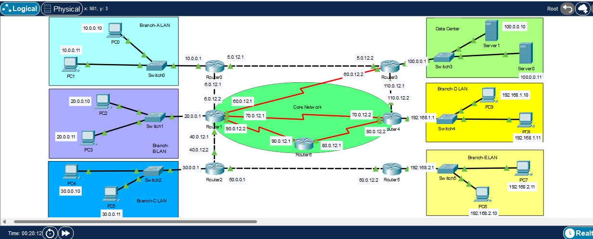

# Multi-Router Enterprise Network Implementation Using RIPv1

A multi-router enterprise network designed and simulated using **Cisco Packet Tracer**. The topology consists of seven routers connecting multiple branch LANs, a central core network, and a data center through multiple WAN links.

The project demonstrates the implementation of **RIPv1 (Routing Information Protocol Version 1)** to exchange routing information and enable communication between different networks.

---

## Topology

| **Item** | **Details** |
|---|---|
| Tool | Cisco Packet Tracer |
| Routers | 7 |
| Switches | 6 |
| End Devices | 10 PCs + 2 Servers |
| LAN Networks | 6 |
| WAN Links | 9 |
| Routing Protocol | RIPv1 |
| Addressing | Classful Default Subnet Masks |
| Topology File | `lab.pkt` |
| Configuration | `configuration.txt` |
| Screenshot | `topology.png` |

### Network Topology Diagram



---

## Topology Summary

- **Branch-A LAN:** Connected to Router0 with two PCs.
- **Branch-B LAN:** Connected to Router1 with two PCs.
- **Branch-C LAN:** Connected to Router2 with two PCs.
- **Data Center:** Connected to Router3 with two servers.
- **Branch-D LAN:** Connected to Router4 with two PCs.
- **Branch-E LAN:** Connected to Router5 with two PCs.
- **Core Network:** Router1 and Router6 provide multiple WAN paths between the connected routers.

---

## IP Addressing Plan

### LAN Networks

| **Network** | **Router IP** | **End Device Addresses** | **Subnet Mask** |
|---|---|---|---|
| Branch-A | 10.0.0.1 | 10.0.0.10, 10.0.0.11 | 255.0.0.0 |
| Branch-B | 20.0.0.1 | 20.0.0.10, 20.0.0.11 | 255.0.0.0 |
| Branch-C | 30.0.0.1 | 30.0.0.10, 30.0.0.11 | 255.0.0.0 |
| Data Center | 100.0.0.1 | 100.0.0.10, 100.0.0.11 | 255.0.0.0 |
| Branch-D | 192.168.1.1 | 192.168.1.10, 192.168.1.11 | 255.255.255.0 |
| Branch-E | 192.168.2.1 | 192.168.2.10, 192.168.2.11 | 255.255.255.0 |

### WAN Links

| **Connection** | **IP Address 1** | **IP Address 2** |
|---|---|---|
| Router0 – Router3 | 5.0.12.1 | 5.0.12.2 |
| Router0 – Router1 | 6.0.12.1 | 6.0.12.2 |
| Router1 – Router2 | 40.0.12.1 | 40.0.12.2 |
| Router2 – Router5 | 50.0.0.1 | 50.0.12.2 |
| Router1 – Router3 | 60.0.12.1 | 60.0.12.2 |
| Router1 – Router4 | 70.0.12.1 | 70.0.12.2 |
| Router4 – Router6 | 80.0.12.2 | 80.0.12.1 |
| Router1 – Router6 | 90.0.12.2 | 90.0.12.1 |
| Router3 – Router4 | 110.0.12.1 | 110.0.12.2 |

*Note: The Router3–Router4 WAN network is corrected to 110.0.0.0/8 to avoid overlapping with Branch-C's 30.0.0.0/8 network. Update the topology label accordingly.*

---

## Network Devices

| **Device** | **Role** |
|---|---|
| Router0–Router6 | Routing between enterprise networks |
| Switch0–Switch5 | LAN connectivity |
| PC0–PC9 | Branch end devices |
| Server0–Server1 | Data center servers |

---

## Technologies Used

- Cisco Packet Tracer
- Cisco IOS CLI
- RIPv1 Dynamic Routing
- IPv4 Addressing
- Classful Routing
- WAN Connectivity
- LAN Networking
- Network Troubleshooting

---

## Configuration and Verification

- Configuring IP addresses on router interfaces.
- Enabling RIPv1 using `router rip` and `version 1`.
- Advertising connected networks using `network` commands.
- Verifying routing tables using `show ip route`.
- Checking routing protocol details using `show ip protocols`.
- Checking interface status using `show ip interface brief`.
- Testing end-to-end connectivity using `ping`.

---

## Project Structure

```text
Multi-Router-Enterprise-Network-Using-RIPv1/
│
├── README.md
├── topology.png
├── configuration.txt
└── lab.pkt
```

---

## How to Use

1. Download the `lab.pkt` file.
2. Open it using Cisco Packet Tracer.
3. Review the network topology and IP addressing plan.
4. Check router configurations in `configuration.txt`.
5. Verify RIPv1 routing tables on all routers.
6. Test connectivity between branch networks and data center servers.

---

## Learning Outcomes

- Understanding multi-router enterprise network design.
- Configuring RIPv1 dynamic routing.
- Understanding classful routing and default subnet masks.
- Learning how routers exchange routing information.
- Analysing routing tables and hop-count metrics.
- Testing communication across multiple LANs.
- Developing network verification and troubleshooting skills.

---

**Project Status:** Completed

**Routing Protocol:** RIPv1

**Tool:** Cisco Packet Tracer
