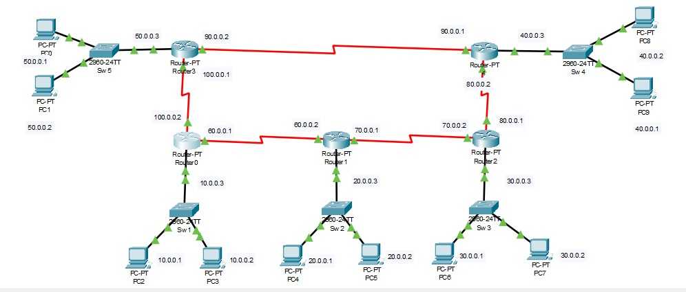

# Multi-Router Enterprise Network Design Using Static Routing

A multi-router enterprise network designed and simulated using **Cisco Packet Tracer**. The topology consists of five routers, five switches, and multiple LAN segments connected through point-to-point router links.

The project demonstrates how static routing can be configured to enable communication between multiple networks across an interconnected enterprise topology.

---

## Topology

| **Item** | **Details** |
|---|---|
| Tool | Cisco Packet Tracer |
| Routers | 5 |
| Switches | 5 |
| End Devices | 10 PCs |
| Routing Method | Static Routing |
| Topology File | `lab.pkt` |
| Configuration | `configuration.txt` |
| Screenshot | `topology.png` |



---

## Topology Summary

- **Router Network:** Five routers (Router0–Router4) interconnected through multiple point-to-point links.
- **LAN 1:** Connected to Router0 through Switch1.
- **LAN 2:** Connected to Router1 through Switch2.
- **LAN 3:** Connected to Router2 through Switch3.
- **LAN 4:** Connected to Router4 through Switch4.
- **LAN 5:** Connected to Router3 through Switch5.
- **End Devices:** Each LAN contains two PCs for connectivity testing.

---

## IP Addressing Plan

### LAN Networks

| **Network** | **Router Interface IP** | **PC Addresses** |
|---|---|---|
| LAN 1 | 10.0.0.3 | 10.0.0.1, 10.0.0.2 |
| LAN 2 | 20.0.0.3 | 20.0.0.1, 20.0.0.2 |
| LAN 3 | 30.0.0.3 | 30.0.0.1, 30.0.0.2 |
| LAN 4 | 40.0.0.3 | 40.0.0.1, 40.0.0.2 |
| LAN 5 | 50.0.0.3 | 50.0.0.1, 50.0.0.2 |

### Router-to-Router Links

| **Connection** | **IP Address 1** | **IP Address 2** |
|---|---|---|
| Router0 – Router1 | 60.0.0.1 | 60.0.0.2 |
| Router1 – Router2 | 70.0.0.1 | 70.0.0.2 |
| Router2 – Router4 | 80.0.0.1 | 80.0.0.2 |
| Router3 – Router4 | 90.0.0.2 | 90.0.0.1 |
| Router3 – Router0 | 100.0.0.1 | 100.0.0.2 |

*Note: IP addresses are taken from the topology diagram. Confirm subnet masks and interface assignments from your actual Packet Tracer configuration.*

---

## Network Devices

| **Device** | **Role** |
|---|---|
| Router0–Router4 | Inter-network routing |
| Switch1–Switch5 | LAN connectivity |
| PC0–PC9 | End devices |

---

## Technologies Used

- Cisco Packet Tracer
- Cisco IOS CLI
- Static Routing
- IPv4 Addressing
- LAN Connectivity
- Router-to-Router Communication
- Network Troubleshooting

---

## Configuration and Verification

The project involves:

- Configuring IP addresses on router interfaces.
- Configuring static routes on routers.
- Establishing communication between different networks.
- Verifying routing tables using `show ip route`.
- Testing end-to-end connectivity using `ping`.
- Troubleshooting routing and connectivity issues.

---

## Project Structure

```text
Multi-Router-Enterprise-Network-Design-Using-Static-Routing/
│
├── README.md
├── topology.png
├── configuration.txt
└── lab.pkt
```

---

## How to Use

1. Download the `lab.pkt` file.
2. Open it using Cisco Packet Tracer.
3. Review the network topology and IP addressing.
4. Check router configurations in `configuration.txt`.
5. Test connectivity between PCs in different LAN networks.

---

## Learning Outcomes

- Understanding multi-router network design.
- Configuring static routes.
- Understanding routing tables and next-hop addresses.
- Establishing communication between multiple LANs.
- Verifying and troubleshooting network connectivity.

---

**Project Status:** Completed

**Tool:** Cisco Packet Tracer
